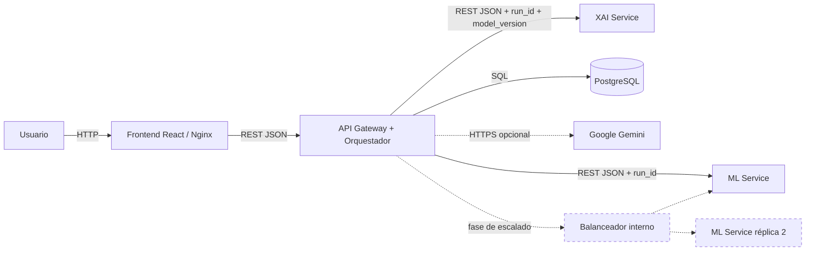
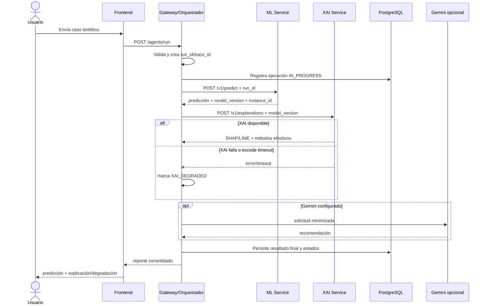

# AnemIA v2: análisis y plan maestro para la evolución distribuida

> Documento de continuidad técnica para el curso de Sistemas Distribuidos.  
> Estado del análisis: 2026-11-08.  
> Alcance: describir la versión funcional actual, precisar qué debe distribuirse y dejar una ruta de implementación verificable.  
> Este documento **no implica que la arquitectura propuesta ya esté implementada**.

---

## 0. Cómo usar este documento

Este archivo debe ser el punto de partida de cualquier persona o IA que continúe AnemIA v2. Antes de cambiar código:

1. Leer completamente este documento.
2. Verificar `git status --short --branch`, `git tag --list` y `git log --oneline --decorate -10`.
3. Confirmar que el tag histórico `anemia-v1-original` sigue apuntando a `fa35893`.
4. Crear la rama de v2 **desde el `main` corregido**, no desde el tag histórico. En el momento de este análisis, `main` apunta a `e965042`.
5. No modificar ni mover el tag `anemia-v1-original`.
6. No incluir `.env`, credenciales, datos clínicos reales ni artefactos privados en commits o imágenes públicas.
7. Implementar por fases y mantener la interfaz pública de la v1 mientras se extraen servicios.

### Línea base Git verificada

| Referencia | Commit | Significado |
|---|---:|---|
| `anemia-v1-original` | `fa35893` | Versión inicial preservada como referencia histórica. |
| `main` | `e965042` | Línea base recomendada para v2; contiene ajustes posteriores de LIME, chat, `run_id` y archivos de despliegue. |

**Regla importante:** el tag original no contiene todas las correcciones posteriores. Volver a construir v2 directamente desde el tag haría perder cambios útiles. La rama nueva debería crearse desde el `main` verificado y registrar en su primer PR/commit el hash exacto de partida.

Comandos sugeridos, que deben ejecutarse solo cuando el equipo decida iniciar v2:

```bash
git status --short --branch
git switch main
git switch -c feature/anemia-v2-distributed
```

---

## 1. Resumen ejecutivo

AnemIA v1 es un prototipo académico funcional para evaluar anemia infantil en Puno. Tiene tres servicios de red en Docker Compose:

1. frontend React servido por Nginx;
2. backend FastAPI;
3. PostgreSQL.

Aunque el backend contiene un “sistema multiagente”, los agentes no son procesos ni servicios independientes. Son clases Python ejecutadas secuencialmente dentro del mismo proceso de FastAPI y comparten un diccionario mutable en memoria. ML, SHAP, LIME, recomendaciones, orquestación y persistencia están empacados en el mismo contenedor backend.

La evolución mínima recomendada para v2 es conservar la interfaz y el flujo clínico, pero extraer primero los dos dominios con mayor costo y valor demostrativo:

- **Servicio ML**: inferencia de Random Forest/XGBoost y estado/versionado de modelos.
- **Servicio XAI**: explicaciones SHAP/LIME usando exactamente la misma versión del artefacto de ML.

El backend actual se convierte gradualmente en **API Gateway + Orquestador**. La persistencia continúa centralizada en PostgreSQL y el frontend sigue consumiendo el contrato existente. Con esto se obtiene comunicación real entre procesos, descubrimiento por DNS, fallos parciales, timeouts, trazabilidad distribuida, escalado independiente y balanceo de réplicas de ML sin inventar un microservicio por cada agente.

### Arquitectura objetivo mínima para la exposición final



Contenedores obligatorios del MVP distribuido:

1. `frontend`
2. `gateway` u `orchestrator`
3. `ml-service`
4. `xai-service`
5. `db`

Para demostrar escalado horizontal se puede agregar una segunda réplica de `ml-service` y un balanceador. El broker de mensajes, Kubernetes, NoSQL y service mesh son extensiones posteriores, no requisitos para el primer MVP distribuido.

---

## 2. HECHOS VERIFICADOS de AnemIA v1

### 2.1 Tecnologías reales

| Capa | Tecnología comprobada | Evidencia principal |
|---|---|---|
| Frontend | React 18, TypeScript, React Router, Axios, Tailwind, Framer Motion, Recharts, Webpack 5 | `frontend/package.json`, `frontend/webpack.config.js`, `frontend/src/` |
| Servidor frontend | Nginx 1.27 Alpine | `Dockerfile.frontend`, `frontend/nginx.conf.template` |
| Backend | Python 3.11 en Docker, FastAPI, Uvicorn, Pydantic | `Dockerfile.backend`, `backend/app/main.py`, `requirements.txt` |
| Persistencia | PostgreSQL 16, SQLAlchemy 2, psycopg2 | `docker-compose.yml`, `backend/app/core/database.py` |
| ML | scikit-learn, imbalanced-learn/SMOTE, Random Forest, XGBoost, joblib | `ml/train_random_forest.py`, `ml/train_xgboost.py`, `ml/inference.py` |
| XAI | SHAP TreeExplainer y LIME Tabular | `explainability/shap_explainer.py`, `explainability/lime_explainer.py` |
| IA externa | Google Gemini por API REST con `httpx`; es opcional | `agents/llm/gemini_client.py`, `agents/recommendation_agent.py` |
| Contenedores | Docker y Docker Compose | `Dockerfile.*`, `docker-compose.yml` |
| Datos locales del navegador | IndexedDB para conversaciones y `localStorage` para preferencias/ID activo | `frontend/src/lib/db.ts`, `frontend/src/lib/storage.ts`, `frontend/src/hooks/useChat.ts` |

La URL del backend no aparece mágicamente por usar el prefijo `REACT_APP_`. `frontend/webpack.config.js` lee `process.env.REACT_APP_API_URL` o el `.env` de la raíz y `webpack.DefinePlugin` la sustituye por un literal durante el build. `Dockerfile.frontend` la recibe como `ARG`. Por tanto, cambiar la variable después de compilar la imagen no cambia el `bundle.js`.

### 2.2 Servicios y límites de proceso actuales

`docker-compose.yml` crea estos servicios:

| Servicio Compose | Proceso/contenedor | Comunicación |
|---|---|---|
| `frontend` | Nginx que sirve la SPA | navegador → `localhost:3000`; navegador → backend configurado en el bundle |
| `backend` | Uvicorn/FastAPI con agentes, ML y XAI dentro | HTTP en `:8000`; SQL hacia `db:5432`; HTTPS hacia Gemini si está configurado |
| `db` | PostgreSQL 16 | protocolo PostgreSQL |
| `pgadmin` | servicio opcional bajo perfil `tools` | administración, no forma parte del flujo clínico |

Los nombres `db` y `backend` pueden resolverse mediante el DNS interno de Docker Compose. En la configuración actual, el navegador no usa el DNS interno: consume el backend por `http://localhost:8000` porque esa URL queda embebida en el frontend.

### 2.3 Lo que NO es un servicio independiente

Los siguientes elementos son módulos importados por el backend y se ejecutan en el mismo proceso/contenedor:

- `agents.data_agent.DataAgent`
- `agents.preprocessing_agent.PreprocessingAgent`
- `agents.prediction_agent.PredictionAgent`
- `agents.explainability_agent.ExplainabilityAgent`
- `agents.recommendation_agent.RecommendationAgent`
- `agents.monitoring_agent.MonitoringAgent`
- `agents.orchestrator_agent.Orchestrator`
- `ml.inference`
- `explainability.shap_explainer`
- `explainability.lime_explainer`
- servicios de `backend/app/services/`

La comunicación entre agentes es una llamada directa de métodos Python. `Orchestrator.run()` crea un diccionario `context`; cada `Agent.run()` llama a `process(context)`, muta ese mismo diccionario y devuelve un `AgentLog`. No hay HTTP, RPC, cola de mensajes, serialización, descubrimiento, reintentos ni aislamiento de fallos entre agentes.

### 2.4 Flujo real de una evaluación

1. El usuario completa el formulario en la SPA.
2. `frontend/src/hooks/useChat.ts` llama a `runAgents()`.
3. `frontend/src/services/api.ts` envía `POST /agents/run` con `{case, model}`.
4. `backend/app/api/routes_agents.py::agents_run()` valida el cuerpo con Pydantic y llama a `run_pipeline()`.
5. `backend/app/services/pipeline_service.py::run_pipeline()` crea un `Orchestrator`, ejecuta el pipeline y luego asigna un `run_id`.
6. `DataAgent` valida rangos, tipos y banderas binarias.
7. `PreprocessingAgent` calcula Hbc con la función compartida de `ml/preprocessing_pipeline.py`.
8. `PredictionAgent` llama directamente a `ml.inference.predict()`.
9. `ml.inference.load_model()` carga perezosamente el `.joblib` y lo conserva con `lru_cache` en el proceso.
10. `ExplainabilityAgent` ejecuta secuencialmente SHAP local, SHAP global y LIME local.
11. `RecommendationAgent` intenta Gemini si hay clave y, si no obtiene una respuesta válida, usa reglas `FALLBACK_RECOMMENDATIONS`.
12. `MonitoringAgent` resume tiempos y errores recogidos hasta ese momento.
13. `Orchestrator._consolidate()` arma un reporte.
14. `pipeline_service.run_pipeline()` agrega `run_id` y llama a `database_service.persist_run()`.
15. PostgreSQL recibe paciente, evaluación, predicción, explicación, recomendación y logs dentro de una transacción. Si la BD no está disponible o la operación falla, la API devuelve el reporte con `persisted=false`.
16. El frontend muestra el resultado y lo conserva por conversación en IndexedDB.
17. Las preguntas posteriores del chat envían al backend tanto el mensaje como el reporte almacenado en el navegador mediante `POST /chat`.

### 2.5 Agentes actuales y responsabilidad real

| Orden | Clase | Responsabilidad real | Dependencias directas |
|---:|---|---|---|
| 1 | `DataAgent` | Validación adicional y normalización del caso | diccionario compartido |
| 2 | `PreprocessingAgent` | Corrección de Hb por altitud y Hbc | `ml.preprocessing_pipeline` |
| 3 | `PredictionAgent` | Inferencia y comparación con reglas clínicas | `ml.inference`, clasificación por reglas |
| 4 | `ExplainabilityAgent` | SHAP global/local, LIME local y factor principal | módulos XAI y modelo local |
| 5 | `RecommendationAgent` | Recomendaciones de Gemini o fallback determinista | `gemini_client`, reglas en memoria |
| 6 | `MonitoringAgent` | Resumen local de tiempos/errores | lista de logs en memoria |
| — | `Orchestrator` | Orden secuencial, corte ante error y consolidación | todos los agentes anteriores |

“Multiagente” describe una separación lógica de responsabilidades, no una arquitectura distribuida.

### 2.6 Modelos y datasets

- Entrenamiento: `data/dataset2024.csv`, unas 41 mil filas antes de controles adicionales.
- Evaluación temporal: `data/dataset2025.csv`, unas 44 mil filas de origen.
- `ml/training_utils.py::load_year_split()` usa 2024 como train y 2025 como test, elimina solapamientos exactos entre años y evita que una observación idéntica aparezca en ambos conjuntos.
- SMOTE se aplica solo al entrenamiento mediante un pipeline de imbalanced-learn.
- La etiqueta es `Dx_anemia` con cuatro clases: Normal, leve, moderada y severa.
- Las features del modelo se definen en `ml/preprocessing_pipeline.py::FEATURE_COLUMNS`.
- Hbc se excluye de las features para evitar fuga directa de la etiqueta; se calcula para el reporte y la referencia clínica.
- Los artefactos contienen al menos pipeline, codificador, métricas y fecha de entrenamiento.
- En la máquina analizada, `random_forest.joblib` mide aproximadamente 121 MB y `xgboost.joblib` aproximadamente 3.6 MB.
- Los `.joblib` están ignorados por `.gitignore`; no están garantizados al clonar el repositorio.
- `Dockerfile.backend` entrena ambos modelos durante el build y conserva un reentrenamiento de emergencia al arrancar si faltan.

Los datasets no son necesarios para la inferencia normal si los artefactos ya existen. LIME sí usa `data/sample/sample_200.csv` para construir su distribución de referencia.

### 2.7 Comportamiento real de SHAP y LIME

- SHAP usa `shap.TreeExplainer`. Ante una excepción pasa a `feature_importances_` y declara `method="feature_importances_fallback"`.
- LIME usa `LimeTabularExplainer` sobre el espacio transformado. Ante una excepción también pasa a `feature_importances_` y declara el fallback.
- Si ni siquiera existe una importancia compatible, ambos pueden devolver `method="unavailable"` y factores vacíos.
- La corrección actual de LIME usa la muestra versionada `data/sample/sample_200.csv`; esta corrección está en `main`, no en el tag original.
- La UI prioriza SHAP local y usa factores LIME como alternativa visual; por ello debe mostrarse el método efectivo para no presentar un fallback como si fuera LIME/SHAP genuino.

### 2.8 Persistencia

El esquema contiene:

- `patients`
- `evaluations`
- `predictions`
- `explanations`
- `recommendations`
- `agent_logs`

En local, PostgreSQL ejecuta `database/schema.sql` y `database/seed.sql` solo al inicializar un volumen vacío. Adicionalmente, `backend/app/core/database.py::init_db()` ejecuta `Base.metadata.create_all()` durante el startup. No existe una secuencia completa de migraciones Alembic versionadas lista para producción.

### 2.9 Endpoints públicos actuales

| Método | Ruta | Función |
|---|---|---|
| GET | `/health` | estado general, BD y modelos |
| GET | `/models/status` | existencia/métricas de modelos |
| POST | `/predict` | inferencia directa |
| POST | `/explain/shap` | explicación SHAP |
| POST | `/explain/lime` | explicación LIME |
| POST | `/agents/run` | pipeline completo |
| GET | `/agents/logs` | logs persistidos |
| GET | `/dashboard` | métricas del panel |
| POST | `/chat` | respuesta conversacional con Gemini |

No hay autenticación, autorización ni control de acceso por rol.

---

## 3. LIMITACIONES Y COSAS A MEJORAR

### 3.1 Limitaciones distribuidas prioritarias

1. **Backend como punto único de fallo.** Si cae FastAPI, caen simultáneamente orquestación, ML, XAI, chat y acceso a persistencia.
2. **Escalado conjunto.** Para escalar SHAP/LIME se replica también toda la API, agentes, dependencias y modelos.
3. **Agentes sin aislamiento.** Un fallo, bloqueo o consumo alto de memoria en XAI afecta a todo el backend.
4. **Ejecución secuencial y sin presupuesto temporal por etapa.** No existen timeouts internos entre agentes.
5. **Sin reintentos controlados ni circuit breaker.** Solo Gemini intenta varios nombres de modelo; no hay política general de resiliencia.
6. **Sin descubrimiento/versionado de servicios.** Compose aporta DNS a los contenedores actuales, pero ML/XAI aún no son servicios.
7. **Trazabilidad incompleta.** El `run_id` se genera después de ejecutar el pipeline, así que no acompaña la ejecución desde el primer paso.
8. **Sin `model_version`.** Dos réplicas podrían servir artefactos distintos sin que el gateway o la respuesta lo detecten.
9. **Observabilidad local.** Los tiempos se miden dentro del proceso; no hay métricas por servicio, trazas distribuidas ni correlación en logs de red.
10. **Persistencia fail-open sin recuperación.** Si PostgreSQL falla, el usuario recibe resultado, pero no existe outbox, cola, reintento ni reconciliación.
11. **Estado de disponibilidad cacheado.** `db_available()` memoriza el primer resultado; si la BD falla inicialmente, el proceso puede continuar considerándola caída aunque se recupere.
12. **Health check ambiguo.** `/health` devuelve `status: ok` incluso si la BD aparece `unavailable`; no distingue liveness de readiness.
13. **Imágenes pesadas y builds lentos.** El backend instala compiladores y entrena modelos en el build. El RF ocupa alrededor de 121 MB sin contar librerías científicas.
14. **Entrenamiento acoplado al despliegue.** Un build nuevo puede producir un artefacto distinto y consume tiempo/CPU innecesariamente.

### 3.2 Seguridad, privacidad y publicación

1. El sistema recibe y persiste información clínica. Aunque sea prototipo, debe tratarse como información sensible.
2. No hay autenticación, autorización, rate limiting ni auditoría de identidad.
3. `/agents/logs` y `/dashboard` son públicos.
4. El frontend conserva formularios, reportes y conversación en IndexedDB. Cualquier persona con acceso al perfil del navegador podría leerlos.
5. `/chat` acepta el reporte proporcionado por el navegador; el servidor no verifica que pertenezca a una ejecución real. Puede ser alterado y usado para inyección de instrucciones hacia Gemini.
6. El prompt del chat contiene datos clínicos y puede enviarlos a un proveedor externo. Esto requiere consentimiento, minimización o datos exclusivamente sintéticos para la demo.
7. CORS no es un control de autenticación. `allow_credentials=True` debe revisarse junto con una lista cerrada de orígenes.
8. Los endpoints capturan excepciones amplias y algunos devuelven detalles internos en el texto del error.
9. No hay límites de tamaño más allá del mensaje de chat ni protección de abuso costoso de SHAP/LIME/Gemini.
10. Las recomendaciones son clínicamente sensibles. Deben conservar siempre el aviso de prototipo académico y validación profesional.

Para una exposición pública, usar únicamente casos sintéticos/de ejemplo, borrar historiales locales al terminar y no habilitar Gemini con información real.

### 3.3 Integridad y consistencia

1. `run_id` tiene 12 caracteres de un UUID truncado; funciona para la demo, pero conviene usar UUID completo.
2. No hay clave idempotente en `POST /agents/run`; un reintento del cliente duplica pacientes/evaluaciones.
3. Las entidades no guardan explícitamente `run_id` en todas las tablas, solo en `agent_logs`.
4. La explicación se almacena como un único registro `method="shap+lime"`, aunque cada método puede haber degradado de forma diferente.
5. Los JSON se serializan como texto en vez de tipos JSON/JSONB.
6. `payload` se trunca a 60 000 caracteres silenciosamente.
7. El seed usa `ON CONFLICT DO NOTHING`, pero no define claves únicas que garanticen que todas sus inserciones sean idempotentes si se ejecuta nuevamente.
8. `Base.metadata.create_all()` no sustituye migraciones versionadas; no puede expresar de forma segura todos los cambios futuros.
9. El pipeline puede finalizar con error y aun así intentar persistir valores por defecto.
10. `Orchestrator._consolidate()` toma el último log para el campo `error`; como Monitoring se ejecuta al final, podría ocultar el mensaje original del agente que falló.

### 3.4 Contratos y mantenibilidad

1. No existe OpenAPI separado/versionado para comunicaciones internas.
2. Los diccionarios compartidos no ofrecen el aislamiento ni la validación de un contrato de red.
3. Parte de la lógica clínica y el esquema ML serán necesarios tanto en ML como en XAI; copiarlos sin estrategia generaría divergencia.
4. El frontend, el backend y la documentación usan “v2” de forma ambigua: `backend/app/main.py` ya declara versión `2.0.0`, aunque arquitectónicamente sigue siendo la v1 del curso.
5. El README indica Python 3.12, mientras `Dockerfile.backend` usa Python 3.11.
6. `requirements.production.txt` existe, pero el `Dockerfile.backend` local instala `requirements.txt`.
7. La documentación histórica puede describir componentes como desacoplados aunque solo estén separados en módulos. El código debe considerarse fuente de verdad.
8. No hay pruebas de contrato entre frontend/gateway/ML/XAI porque esos límites todavía no existen.

### 3.5 ML y XAI

1. Los artefactos `.joblib` no tienen un identificador de versión/hash expuesto por API.
2. Cargar un `.joblib` no confiable permite ejecución de código; los artefactos deben proceder de una fuente controlada y verificarse por checksum.
3. La reproducibilidad depende de versiones exactas de Python y librerías serializadas.
4. `model_status()` abre cada `.joblib` en cada consulta para recuperar metadatos, en lugar de usar manifiestos pequeños/cacheados.
5. SHAP y LIME degradan silenciosamente desde el punto de vista clínico si la UI no destaca el campo `method`.
6. LIME construye un explicador en cada solicitud; el fondo está cacheado, pero el explicador no.
7. Ejecutar SHAP global en cada evaluación es redundante porque la importancia global solo cambia con la versión del modelo.
8. ML y XAI deben usar exactamente el mismo preprocesador, orden de clases y artefacto. Una discrepancia produciría explicaciones de otro modelo.
9. La clase severa es extremadamente minoritaria; accuracy alta no basta. Deben conservarse recall/F1 por clase, balanced accuracy, PR-AUC y matriz de confusión.
10. El sistema ofrece simultáneamente predicción ML y referencia por umbrales clínicos. La interfaz debe explicar una eventual discrepancia, no ocultarla.

### 3.6 Experiencia de usuario y operación

1. El timeout global de Axios es 60 s, pero no hay mensajes distintos para “ML caído”, “XAI degradado” o “Gemini no disponible”.
2. La conversación vive principalmente en el navegador; no existe sincronización multiusuario ni separación por cuenta.
3. No existe un procedimiento automático de borrado/retención de datos.
4. Los estados de los seis agentes que ve la UI son representaciones del pipeline; en v2 deben reflejar resultados reales y no animaciones desconectadas de la ejecución.
5. El PDF generado desde el cliente debe incluir `run_id`, versión del modelo, método XAI real y carácter académico del resultado.

---

## 4. OBJETIVOS DE ANEMIA V2

### 4.1 Objetivo general

Transformar AnemIA en un prototipo distribuido demostrable que mantenga su funcionalidad clínica académica y permita desplegar, escalar, observar y hacer fallar de forma independiente la inferencia ML y la explicabilidad XAI.

### 4.2 Objetivos técnicos verificables

- ML y XAI corren en procesos/contenedores independientes del gateway.
- Las llamadas se realizan por red con REST/JSON y contratos versionados.
- Cada ejecución obtiene `run_id`/`trace_id` antes del primer paso y lo propaga a todos los servicios.
- Toda respuesta de ML/XAI incluye `service_version` y `model_version`.
- ML es stateless y admite al menos dos réplicas detrás de balanceo.
- Un fallo de XAI no impide entregar la predicción; la respuesta indica degradación parcial.
- Un fallo de ML sí detiene el diagnóstico y produce un error controlado, sin inventar resultado.
- El gateway aplica timeouts, reintentos limitados solo donde sean seguros y circuit breaker básico.
- Hay liveness/readiness independientes y logs estructurados por servicio.
- PostgreSQL mantiene trazabilidad de cada ejecución y sus estados.
- La v1 permanece recuperable por tag y la interfaz pública principal sigue compatible durante la migración.

### 4.3 No objetivos del primer MVP

- No separar un microservicio por cada agente.
- No introducir Kubernetes solo por demostración.
- No usar blockchain, NoSQL, SOAP o WebSockets sin un caso de uso real.
- No convertir el prototipo en dispositivo o sistema médico certificado.
- No entrenar modelos en cada arranque o despliegue.
- No publicar datos reales ni abrir una API clínica anónima a Internet.

---

## 5. ARQUITECTURA PROPUESTA

### 5.1 Responsabilidades por servicio

#### A. `frontend`

Conservar React/Nginx. Debe hablar solo con el gateway público. No debe conocer las URL internas de ML, XAI o PostgreSQL.

#### B. `gateway` / `orchestrator-service`

Evolución del backend actual. Responsabilidades:

- contrato externo compatible con `/agents/run`;
- validación de entrada;
- generación temprana de `run_id` y `trace_id`;
- corrección clínica por altitud o invocación de una librería compartida versionada;
- coordinación de ML, XAI y recomendaciones;
- política de timeouts/reintentos/degradación;
- persistencia y respuesta consolidada;
- autenticación/autorización si el prototipo se publica;
- agregación de health/readiness para la UI, sin falsear dependencias.

No debe cargar modelos ML ni importar implementaciones concretas de SHAP/LIME cuando termine la extracción.

#### C. `ml-service`

Servicio stateless de inferencia:

- carga artefactos ya entrenados y verificados;
- expone modelos disponibles y sus versiones;
- valida el esquema de features;
- devuelve probabilidades, clase, Hbc/reportes requeridos y metadatos;
- precarga modelos en startup/readiness;
- no accede a la BD principal;
- no entrena en runtime;
- puede replicarse horizontalmente.

#### D. `xai-service`

Servicio stateless de explicabilidad:

- carga la misma versión del artefacto usada por ML;
- genera SHAP local y LIME local;
- cachea SHAP global por `model_version`;
- devuelve el método efectivo: `shap`, `lime`, `feature_importances_fallback` o `unavailable`;
- no persiste datos clínicos;
- limita concurrencia y tiempo de cómputo;
- puede degradar sin invalidar una predicción ya obtenida.

**Decisión recomendada:** XAI debe cargar el artefacto localmente, no hacer cientos/miles de llamadas de red a ML durante LIME. Ambos servicios deben obtener el mismo artefacto inmutable por versión/checksum.

#### E. `postgres`

Persistencia única del MVP. El gateway será el único propietario/escritor de los datos clínicos. ML y XAI no deben conectarse a la base principal.

#### F. Gemini externo

Continuar como dependencia opcional. Las recomendaciones deterministas deben mantenerse como fallback. Para demo pública, usar casos sintéticos y una política explícita para no enviar identificadores personales.

### 5.2 Por qué no separar todos los agentes

`DataAgent` y `PreprocessingAgent` son rápidos, deterministas y fuertemente ligados al contrato de entrada. Separarlos añadiría latencia y puntos de fallo sin aportar escalado útil. `MonitoringAgent` debe evolucionar hacia observabilidad transversal, no convertirse necesariamente en un microservicio. El mayor beneficio está en aislar ML/XAI por consumo, dependencias, versionado y escalado.

### 5.3 Comunicación

Para el MVP:

- REST/JSON interno;
- DNS de Docker Compose (`http://ml-service:8001`, `http://xai-service:8002`);
- `X-Run-ID`, `traceparent` o ambos en cada llamada;
- timeouts separados de conexión y lectura;
- propagación de errores con códigos estables;
- ninguna URL interna en el bundle del frontend.

Un broker (RabbitMQ/Redis Streams) puede incorporarse después para trabajos XAI asíncronos, auditoría o reintentos. No es necesario para demostrar distribución sincrónica real.

### 5.4 Flujo objetivo



---

## 6. CONTRATOS INTERNOS PROPUESTOS

Los nombres pueden cambiar, pero los conceptos no deben omitirse. Versionar las rutas internas desde el inicio.

### 6.1 `POST /v1/predict` en ML

Solicitud mínima:

```json
{
  "run_id": "uuid-completo",
  "requested_model": "random_forest",
  "case": {
    "Sexo": "F",
    "EdadMeses": 53.62,
    "Hemoglobina": 13.7,
    "AlturaREN": 3877,
    "ProvinciaREN": "SANROMAN",
    "Juntos": 0,
    "SIS": 1,
    "Qaliwarma": 0,
    "Cred": 1,
    "Suplementacion": 1,
    "Consejeria": 0,
    "Sesion": 0
  }
}
```

Respuesta mínima:

```json
{
  "run_id": "uuid-completo",
  "service": "ml-service",
  "service_version": "2.0.0",
  "instance_id": "ml-2",
  "model_name": "random_forest",
  "model_version": "rf-2024train-2025test-sha256...",
  "diagnosis_code": "Normal",
  "diagnosis_label": "Normal",
  "probability": 99.1,
  "class_probabilities": {
    "Normal": 0.991,
    "AnemiaLeve": 0.008,
    "AnemiaModerada": 0.001,
    "AnemiaSevera": 0.0
  },
  "hbc": 11.06,
  "duration_ms": 15.4
}
```

### 6.2 `POST /v1/explanations` en XAI

Debe recibir el caso, la clase predicha y la versión exacta del modelo. Si el servicio no posee esa versión debe responder con conflicto controlado, no explicar con otra versión.

```json
{
  "run_id": "uuid-completo",
  "model_name": "random_forest",
  "model_version": "rf-2024train-2025test-sha256...",
  "predicted_class": "Normal",
  "case": { "...": "mismo esquema validado" },
  "methods": ["shap", "lime"]
}
```

Respuesta:

```json
{
  "run_id": "uuid-completo",
  "service_version": "2.0.0",
  "model_version": "rf-2024train-2025test-sha256...",
  "status": "complete",
  "shap": { "method": "shap", "factors": [] },
  "lime": { "method": "lime", "factors": [] },
  "duration_ms": 210.0
}
```

Estados recomendados: `complete`, `partial`, `degraded`, `unavailable`.

### 6.3 Errores uniformes

```json
{
  "error": {
    "code": "MODEL_VERSION_NOT_AVAILABLE",
    "message": "La versión solicitada no está cargada.",
    "retryable": false,
    "run_id": "uuid-completo"
  }
}
```

Códigos mínimos:

- `INVALID_CASE`
- `MODEL_NOT_AVAILABLE`
- `MODEL_VERSION_NOT_AVAILABLE`
- `INFERENCE_TIMEOUT`
- `XAI_TIMEOUT`
- `DEPENDENCY_UNAVAILABLE`
- `INTERNAL_ERROR`

### 6.4 Compatibilidad externa

El frontend puede seguir llamando `POST /agents/run`. El gateway adapta las respuestas internas al tipo actual `AgentRunResponse`. Después se puede crear `/api/v2/evaluations`, pero no es necesario romper la v1 durante la primera extracción.

---

## 7. MODELOS, ARTEFACTOS Y REPRODUCIBILIDAD

### 7.1 Política recomendada

1. Entrenar fuera del arranque y fuera del request.
2. Generar artefactos una vez en una tarea controlada.
3. Crear un `manifest.json` por versión con:
   - nombre y versión;
   - SHA-256 del `.joblib`;
   - fecha y commit de entrenamiento;
   - datasets y hashes;
   - versiones de Python/scikit-learn/XGBoost;
   - esquema/orden de features;
   - clases y métricas de validación;
   - parámetros y `random_state`.
4. Empaquetar el artefacto validado en las imágenes de ML y XAI para el MVP académico, o descargarlo de un almacenamiento privado al startup.
5. Verificar checksum antes de cargar.
6. Exponer `model_version` y checksum abreviado en `/ready` y en cada respuesta.

Empaquetar los `.joblib` en las imágenes evita reentrenar en despliegue y simplifica la demo, pero duplica el artefacto entre ML/XAI y aumenta el tamaño. Es un intercambio aceptable para el MVP. Un registry/almacenamiento de artefactos es la evolución posterior.

### 7.2 Compatibilidad

- Fijar versiones de dependencias de runtime.
- Probar deserialización dentro de la imagen final.
- No aceptar rutas de artefactos suministradas por usuarios.
- Mantener el preprocesador junto con el estimador en el artefacto.
- Hacer una prueba “golden case” que compare v1 y v2 con tolerancias definidas.

---

## 8. DATOS Y PERSISTENCIA EN V2

### 8.1 Propiedad de datos

En el MVP, el gateway es el único servicio con acceso a PostgreSQL. Esto evita una base compartida libremente por todos los servicios. ML/XAI son stateless y reciben solo lo necesario.

### 8.2 Cambios mínimos del esquema

Agregar mediante migraciones versionadas:

- `run_id UUID UNIQUE NOT NULL` en una entidad de ejecución/evaluación;
- `trace_id`;
- `status` (`IN_PROGRESS`, `COMPLETED`, `PARTIAL`, `FAILED`);
- `idempotency_key` opcional y única;
- `service_versions JSONB`;
- `model_name` y `model_version`;
- método real y estado de SHAP/LIME;
- errores/degradaciones estructurados;
- timestamps de inicio/fin;
- duraciones por servicio;
- política de retención o `expires_at` para demos.

No guardar prompts completos, trazas con datos sensibles ni respuestas innecesarias de proveedores externos.

### 8.3 Migraciones

- Inicializar Alembic correctamente desde los modelos actuales.
- Crear una migración baseline que represente el esquema existente.
- Ejecutar `alembic upgrade head` como tarea explícita y controlada, no desde varias réplicas simultáneas.
- Conservar `schema.sql` solo para demos nuevas si el equipo lo necesita, evitando dos fuentes de verdad a largo plazo.

### 8.4 Idempotencia

El frontend debe poder enviar `Idempotency-Key`. El gateway guarda la clave y, ante un reintento, devuelve la misma ejecución en vez de duplicar registros. No reintentar automáticamente operaciones no idempotentes sin esta protección.

---

## 9. RESILIENCIA Y SEMÁNTICA DE FALLOS

### 9.1 Clasificación de dependencias

| Dependencia | ¿Crítica? | Comportamiento recomendado |
|---|---|---|
| ML | Sí | Sin predicción no emitir diagnóstico; responder error controlado. |
| XAI | No para la predicción | Devolver resultado parcial con `xai_status=degraded`. |
| PostgreSQL | Depende del modo | En demo puede responder con `persisted=false`; en modo auditado debería exigir persistencia. |
| Gemini | No | Usar fallback MINSA y declarar `engine=fallback`. |

### 9.2 Timeouts iniciales a medir, no asumir

- conexión interna: 0.5–1 s;
- inferencia ML: presupuesto inicial 3–5 s;
- XAI: presupuesto inicial 10–20 s;
- Gemini: mantener un límite explícito cercano a los 15 s actuales;
- request externo total: menor que los 60 s del frontend.

Estos valores son hipótesis iniciales. Deben ajustarse con p50/p95/p99 medidos en el equipo de la demo.

### 9.3 Reintentos

- máximo 1 reintento para conexión rechazada/timeout transitorio en llamadas idempotentes;
- backoff breve con jitter;
- no reintentar errores 4xx ni incompatibilidad de versión;
- no multiplicar reintentos entre todas las capas;
- registrar intento y destino/instancia.

### 9.4 Circuit breaker

Puede implementarse en el gateway con estados cerrado/abierto/semiabierto. Es especialmente útil para XAI o Gemini, evitando saturar una dependencia caída. Para la exposición basta demostrar que el gateway deja de insistir temporalmente y responde degradado.

### 9.5 Apagado y arranque

- liveness: el proceso está vivo;
- readiness: modelos cargados, checksum válido y servicio listo para tráfico;
- startup probe o periodo de gracia para carga de artefactos;
- manejar SIGTERM y dejar terminar requests en curso;
- no marcar ready antes de cargar modelos.

---

## 10. OBSERVABILIDAD DISTRIBUIDA

### 10.1 Logs estructurados

Cada servicio debe emitir JSON con al menos:

- timestamp UTC;
- nivel;
- `service` y `service_version`;
- `instance_id`;
- `run_id` y `trace_id`;
- operación/endpoint;
- duración;
- resultado y código de error;
- `model_version` cuando corresponda.

No registrar el caso clínico completo, API keys ni cadenas de conexión.

### 10.2 Métricas mínimas

- cantidad de requests por servicio/endpoint/estado;
- latencia p50/p95/p99;
- errores y timeouts;
- circuit breaker abierto;
- inferencias por modelo/versión;
- conteo de fallbacks SHAP/LIME/Gemini;
- memoria/CPU por contenedor;
- conexiones y errores de PostgreSQL.

Prometheus/Grafana es una mejora excelente, pero para el MVP también puede demostrarse con endpoints `/metrics`, logs y `docker stats` si el tiempo es limitado.

### 10.3 Trazas

OpenTelemetry es la opción recomendada. Una traza debe mostrar:

`frontend/gateway → validación → ml-service → xai-service → persistencia → respuesta`.

Si no se implementa un collector en la primera fase, al menos propagar `run_id` y `trace_id` y registrar spans/duraciones consistentes.

---

## 11. SEGURIDAD MÍNIMA

Antes de una publicación accesible desde Internet:

- autenticación para endpoints clínicos y de auditoría;
- roles básicos (`demo`, `operador`, `admin`) si aplica;
- rate limiting por IP/usuario;
- HTTPS en el borde;
- secretos solo por variables/secret manager;
- CORS con orígenes exactos;
- endpoints internos no expuestos al host/Internet cuando Compose lo permita;
- validación estricta de request/response;
- límites de tamaño y concurrencia;
- cabeceras de seguridad en Nginx;
- casos exclusivamente sintéticos en demostraciones públicas;
- botón/procedimiento para borrar historial del navegador;
- retención corta en la BD de demo;
- sanitización de errores;
- revisión de dependencia y escaneo de imagen;
- disclaimer visible: apoyo académico, no diagnóstico ni tratamiento médico.

No enviar nombres, documentos, direcciones ni identificadores directos a Gemini. Idealmente el chat debe recuperar un reporte validado por `run_id` desde el servidor, no confiar en un reporte arbitrario enviado por el navegador.

---

## 12. ESTRUCTURA DE REPOSITORIO SUGERIDA

La migración puede mantenerse en un monorepo:

```text
services/
  gateway/
    app/
    tests/
    Dockerfile
  ml_service/
    app/
    tests/
    Dockerfile
  xai_service/
    app/
    tests/
    Dockerfile
packages/
  contracts/
    anemia_contracts/       # modelos Pydantic y errores compartidos
  clinical_core/
    anemia_clinical/        # corrección de altitud y reglas puras
  model_runtime/
    anemia_model_runtime/   # carga/validación común, si se justifica
artifacts/
  manifests/                # manifiestos sin datos/secretos
frontend/
database/
infra/
  compose/
  observability/
docs/
```

Evitar que `gateway` importe directamente el código ejecutable de ML/XAI. Los paquetes compartidos deben contener contratos o funciones puras, no convertir los servicios de nuevo en un monolito oculto.

---

## 13. PLAN DE IMPLEMENTACIÓN POR FASES

### Fase 0 — Congelar y medir la línea base

Entregables:

- rama v2 creada desde `main` corregido;
- tag original verificado e intacto;
- tests actuales en verde;
- conjunto de casos “golden” sintéticos con respuestas esperadas;
- medidas de latencia/memoria para `/predict`, SHAP, LIME y `/agents/run`;
- hashes de los artefactos actuales;
- diagrama v1 confirmado.

Criterio de salida: la v1 puede reconstruirse y sus resultados principales están registrados para comparar.

### Fase 1 — Contratos y trazabilidad sin distribuir todavía

Cambios:

- generar UUID completo antes del pipeline;
- agregar `trace_id`, `model_version` y `service_version`;
- definir modelos Pydantic compartidos;
- separar liveness/readiness;
- logs JSON;
- corregir propagación del error original;
- preparar migración de BD e idempotencia.

Criterio de salida: la v1 sigue funcionando, pero ya usa contratos que después cruzarán la red.

### Fase 2 — Extraer `ml-service`

Cambios:

- crear FastAPI interno para ML;
- mover carga e inferencia;
- eliminar entrenamiento de startup/request;
- empaquetar artefactos versionados;
- cliente HTTP en gateway con timeout/reintento;
- pruebas de contrato y paridad;
- Compose con health/readiness.

Criterio de salida: apagar `ml-service` produce un error controlado; levantarlo recupera el flujo sin reiniciar todo el sistema.

### Fase 3 — Extraer `xai-service`

Cambios:

- mover SHAP/LIME;
- asegurar modelo/checksum idéntico al de ML;
- cachear SHAP global y explicador LIME cuando sea seguro;
- limitar concurrencia;
- degradación parcial explícita;
- pruebas del fallback real.

Criterio de salida: con XAI apagado aún se entrega predicción y se informa que la explicación no está disponible.

### Fase 4 — Escalado y balanceo de ML

Cambios:

- dos réplicas ML;
- balanceador Nginx/Traefik o mecanismo equivalente;
- `instance_id` en respuestas/logs;
- prueba concurrente y demostración de distribución entre réplicas;
- prueba de caída de una réplica.

Criterio de salida: las solicitudes aparecen en ambas instancias y el sistema sigue respondiendo al detener una.

### Fase 5 — Observabilidad y seguridad de demo

Cambios:

- métricas, dashboard y trazas;
- rate limiting;
- protección de endpoints de logs/dashboard;
- sanitización y retención;
- limpieza de historial del navegador;
- documentación operativa.

Criterio de salida: una ejecución puede seguirse de extremo a extremo y una falla puede diagnosticarse por logs/métricas.

### Fase 6 — Opcionales posteriores

- cola para XAI asíncrono;
- registry/almacenamiento de modelos;
- despliegue cloud;
- Kubernetes si existe necesidad de orquestación real;
- CI/CD con escaneo, contratos y rollback automático;
- canary de una nueva versión de modelo.

---

## 14. BACKLOG PRIORIZADO

### P0 — imprescindible

- [ ] Crear rama v2 desde el `main` corregido.
- [ ] Añadir casos golden y pruebas de paridad v1/v2.
- [ ] Versionar contratos internos.
- [ ] Generar `run_id` antes de orquestar y propagarlo.
- [ ] Introducir `model_version` verificable.
- [ ] Extraer ML a un proceso/contenedor con REST.
- [ ] Extraer XAI a un proceso/contenedor con REST.
- [ ] Aplicar timeouts y degradación XAI.
- [ ] Eliminar entrenamiento de runtime/despliegue normal.
- [ ] Crear manifiestos/checksums de modelos.
- [ ] Crear migraciones de BD.
- [ ] Añadir health/readiness reales.
- [ ] Probar caída y recuperación de servicios.
- [ ] Mantener compatibilidad de `/agents/run`.

### P1 — muy recomendable

- [ ] Idempotency key.
- [ ] Logs JSON correlacionados.
- [ ] Métricas por servicio.
- [ ] Dos réplicas ML y balanceo.
- [ ] Circuit breaker.
- [ ] Autenticación/rate limit si se expone públicamente.
- [ ] Proteger `/agents/logs` y `/dashboard`.
- [ ] Guardar métodos XAI reales y estados separados.
- [ ] Cachear SHAP global por versión.
- [ ] Recuperar el reporte del chat por `run_id` en servidor.

### P2 — evolución

- [ ] OpenTelemetry con collector.
- [ ] Broker para procesos asíncronos.
- [ ] Model registry.
- [ ] Despliegue orquestado en nube/Kubernetes.
- [ ] Canary/blue-green de modelos.
- [ ] Pruebas de caos automatizadas.

---

## 15. ESTRATEGIA DE PRUEBAS

### 15.1 Unitarias

- corrección por altitud y clasificación clínica;
- validación de contratos;
- mapeo de clases/probabilidades;
- generación/propagación de IDs;
- política de fallback;
- serialización de errores.

### 15.2 Paridad ML/XAI

- mismos casos y artefacto en v1/v2;
- misma clase predicha;
- probabilidades iguales dentro de tolerancia numérica;
- mismos nombres/orden de clases;
- Hbc idéntica;
- SHAP/LIME devuelven método efectivo y factores válidos;
- incompatibilidad de `model_version` rechazada.

### 15.3 Contrato

- gateway ↔ ML;
- gateway ↔ XAI;
- frontend ↔ gateway;
- validación automática del OpenAPI/JSON schema;
- compatibilidad hacia atrás de `/agents/run`.

### 15.4 Integración Compose

- arranque desde cero;
- readiness antes de tráfico;
- evaluación completa;
- persistencia y consulta;
- Gemini ausente → fallback;
- reinicio de cada contenedor;
- volumen PostgreSQL conservado.

### 15.5 Fallos distribuidos

- ML apagado;
- XAI apagado;
- una réplica ML apagada;
- latencia artificial/timeout;
- respuesta inválida;
- versión de modelo incompatible;
- PostgreSQL temporalmente caído y recuperado;
- Gemini sin clave, sin cuota o timeout;
- circuit breaker abierto y semiabierto.

### 15.6 Carga

Medir por separado:

- `/v1/predict`;
- SHAP;
- LIME;
- pipeline completo;
- 1 vs. 2 réplicas ML;
- consumo de memoria por servicio;
- tiempo de carga inicial de modelos.

Herramientas posibles: `pytest`, `httpx`, k6/Locust, `docker stats`, métricas de Prometheus. Registrar hardware, concurrencia, número de muestras y percentiles; no reportar solo un promedio.

### 15.7 Seguridad y privacidad

- CORS cerrado;
- endpoints internos no publicados;
- límites de request;
- logs sin datos clínicos completos;
- secretos ausentes de Git e imágenes;
- borrado/retención;
- prompt injection del chat;
- acceso no autorizado a logs/dashboard.

---

## 16. CRITERIOS DE ACEPTACIÓN PARA LA DEMOSTRACIÓN FINAL

La v2 puede considerarse distribuida y demostrable cuando:

1. `docker compose ps` muestra al menos frontend, gateway, ML, XAI y PostgreSQL.
2. ML y XAI tienen procesos, puertos internos, health checks y Dockerfiles propios.
3. El gateway los llama por red; no importa sus funciones de inferencia/explicabilidad.
4. Una evaluación correcta conserva los resultados funcionales de la v1.
5. La respuesta y logs muestran `run_id`, `model_version` e instancia.
6. Se observan solicitudes en dos réplicas ML o se justifica por qué el MVP usa una.
7. Al apagar XAI, la predicción sigue disponible con estado degradado.
8. Al apagar una réplica ML, el balanceador continúa con la otra.
9. Al apagar ML por completo, el gateway responde un error claro y no fabrica diagnóstico.
10. Al no configurar Gemini, el fallback funciona y se identifica.
11. Los datos persistidos pueden correlacionarse con el mismo `run_id`.
12. No hay credenciales ni datos clínicos reales en Git, logs o la demostración.
13. Existe evidencia de pruebas de contrato, integración y fallo.
14. Se puede volver a la v1 usando la referencia Git preservada.

### Guion técnico corto sugerido

1. Mostrar arquitectura v1 y explicar que los agentes son módulos internos.
2. Mostrar `docker compose ps` de v2.
3. Ejecutar un caso sintético.
4. Seguir `run_id` por gateway, ML y XAI.
5. Mostrar `model_version` y la instancia ML.
6. Repetir varias solicitudes para evidenciar balanceo.
7. Detener una réplica ML y repetir.
8. Detener XAI y mostrar degradación parcial.
9. Restaurar servicios y mostrar recuperación.
10. Cerrar con métricas de latencia/recursos y trade-offs.

---

## 17. DESPLIEGUE Y ROLLBACK

### 17.1 Desarrollo local

Docker Compose es suficiente y pedagógicamente útil: aporta red, DNS, aislamiento, health checks, volúmenes y escalado básico. Evitar `container_name` en servicios que deban escalar porque impide réplicas con nombres únicos.

### 17.2 Imágenes

- multi-stage builds;
- dependencias mínimas por servicio;
- usuario no root;
- tags inmutables por commit;
- checksum/manifest del modelo;
- sin compiladores en la imagen runtime cuando sea posible;
- ML y XAI pueden tener imágenes distintas para no duplicar dependencias innecesarias.

### 17.3 Rollback

Antes de cada hito:

- tag/release de la versión estable;
- backup de PostgreSQL antes de migraciones;
- migraciones compatibles hacia atrás cuando sea posible;
- imágenes anteriores conservadas por digest/tag;
- artefacto de modelo anterior disponible;
- variables de servicio con valores conocidos.

Rollback del MVP:

1. detener Compose v2;
2. restaurar la versión de Compose e imágenes anteriores;
3. revertir solo migraciones expresamente reversibles o restaurar backup;
4. levantar la versión anterior;
5. probar `/health`, `/models/status` y un caso golden;
6. no mover el tag `anemia-v1-original` para “hacerlo coincidir”.

---

## 18. DECISIONES QUE DEBEN REGISTRARSE COMO ADR

Crear pequeños Architecture Decision Records para:

1. REST interno vs. gRPC.
2. XAI síncrono vs. asíncrono.
3. artefactos embebidos vs. almacenamiento/registry.
4. modelo de propiedad de PostgreSQL.
5. manejo de falla de persistencia.
6. autenticación elegida para una publicación.
7. réplica/balanceador elegido.
8. librerías compartidas y estrategia de versionado.
9. observabilidad elegida.
10. política de retención y privacidad.

Cada ADR debe incluir contexto, decisión, alternativas y consecuencias. Esto demuestra el rol de arquitectos de software, no solo la adición de contenedores.

---

## 19. ASPECTOS PENDIENTES DE VALIDACIÓN

No deben presentarse como hechos hasta medirlos o decidirlos:

- presupuesto real de memoria de ML y XAI cuando estén separados;
- latencia p95/p99 y concurrencia objetivo;
- cantidad de usuarios simultáneos de la demo;
- si se usará nube o exclusivamente Docker local/AnyDesk;
- proveedor y límites gratuitos si se despliega posteriormente;
- política institucional sobre datos clínicos y Gemini;
- procedencia/licencia exacta de datasets y permiso de redistribución;
- autoría/licencia de los artefactos `.joblib`;
- validez clínica formal de la fórmula y recomendaciones fuera del uso académico;
- umbral de aceptación para paridad de probabilidades;
- necesidad real de procesamiento XAI asíncrono;
- si PostgreSQL debe ser obligatorio o fail-open;
- herramienta final de balanceo, métricas y trazas;
- mecanismo de autenticación;
- política de backup y retención;
- ubicación definitiva de los artefactos de modelos.

---

## 20. REGLAS PARA LA IA O PERSONA QUE CONTINÚE

1. No afirmar que un componente es microservicio solo porque está en otra carpeta.
2. Confirmar siempre el límite de proceso y la comunicación de red.
3. No eliminar la funcionalidad de fallback de Gemini.
4. No ocultar fallbacks de SHAP/LIME: exponer el método real.
5. No entrenar automáticamente ante una solicitud de usuario.
6. No introducir una tecnología solo para mencionar el sílabo; justificarla con un problema concreto.
7. No romper `/agents/run` hasta tener migración del frontend y pruebas.
8. No copiar lógica clínica en varios servicios sin una fuente versionada.
9. No permitir que ML y XAI usen versiones distintas del modelo.
10. No compartir una base de datos sin propietario claro entre todos los servicios.
11. No registrar casos clínicos completos en logs.
12. No commitear `.env`, claves, dumps, historiales ni modelos privados.
13. No borrar volúmenes Docker ni recursos de otros proyectos durante pruebas.
14. Hacer cambios pequeños, medibles y reversibles.
15. Actualizar este documento y los ADR cuando una propuesta se convierta en implementación.

### Checklist de inicio de cada sesión

- [ ] Leer este documento y los ADR nuevos.
- [ ] Revisar `git status` y rama.
- [ ] Confirmar línea base/tag.
- [ ] Revisar Compose y servicios realmente activos.
- [ ] Ejecutar pruebas relevantes antes del cambio.
- [ ] Definir criterio de aceptación del cambio.
- [ ] Evitar credenciales/datos reales.
- [ ] Ejecutar pruebas y registrar evidencia después.
- [ ] Actualizar contratos/documentación si cambian.

---

## 21. REFERENCIAS DE CÓDIGO QUE SON FUENTE DE VERDAD

| Tema | Archivo / símbolo |
|---|---|
| Composición actual | `docker-compose.yml` |
| Backend Docker | `Dockerfile.backend` |
| Frontend Docker | `Dockerfile.frontend` |
| URL pública en build | `frontend/webpack.config.js::loadEnv` y `DefinePlugin` |
| Cliente HTTP | `frontend/src/services/api.ts` |
| Estado por conversación | `frontend/src/hooks/useChat.ts`, `frontend/src/lib/db.ts` |
| Entrada FastAPI | `backend/app/main.py` |
| Configuración | `backend/app/core/config.py::Settings` |
| Conexión/estado BD | `backend/app/core/database.py` |
| Orquestación backend | `backend/app/services/pipeline_service.py::run_pipeline` |
| Orquestador de agentes | `agents/orchestrator_agent.py::Orchestrator` |
| Ejecución común | `agents/base.py::Agent.run` |
| Inferencia | `ml/inference.py::predict` y `load_model` |
| Esquema de features | `ml/preprocessing_pipeline.py` |
| Entrenamiento temporal | `ml/training_utils.py::load_year_split` |
| Random Forest | `ml/train_random_forest.py` |
| XGBoost | `ml/train_xgboost.py` |
| SHAP | `explainability/shap_explainer.py` |
| LIME | `explainability/lime_explainer.py` |
| Gemini | `agents/llm/gemini_client.py` |
| Recomendación/fallback | `agents/recommendation_agent.py` |
| Persistencia | `backend/app/services/database_service.py` |
| Modelos ORM | `backend/app/models/db_models.py` |
| SQL inicial | `database/schema.sql`, `database/seed.sql` |
| Contratos actuales | `backend/app/schemas/`, `frontend/src/types/` |
| Pruebas actuales | `backend/tests/` |

---

## 22. Conclusión

AnemIA no necesita una reescritura total para convertirse en un proyecto distribuido defendible. La estrategia de menor riesgo es preservar el frontend y el contrato externo, convertir el backend en gateway/orquestador y extraer ML y XAI como servicios stateless versionados. Esto ataca los problemas reales de aislamiento, consumo, escalado y tolerancia a fallos, y permite demostrar conceptos del curso: comunicación entre procesos, DNS/descubrimiento, REST/JSON, contenedores, replicación, balanceo, transparencia de acceso, fallos parciales y observabilidad.

El éxito de v2 no se mide por el número de microservicios, sino por límites claros, contratos verificables, coherencia del modelo, fallos controlados, trazabilidad y capacidad de recuperar la versión estable.
